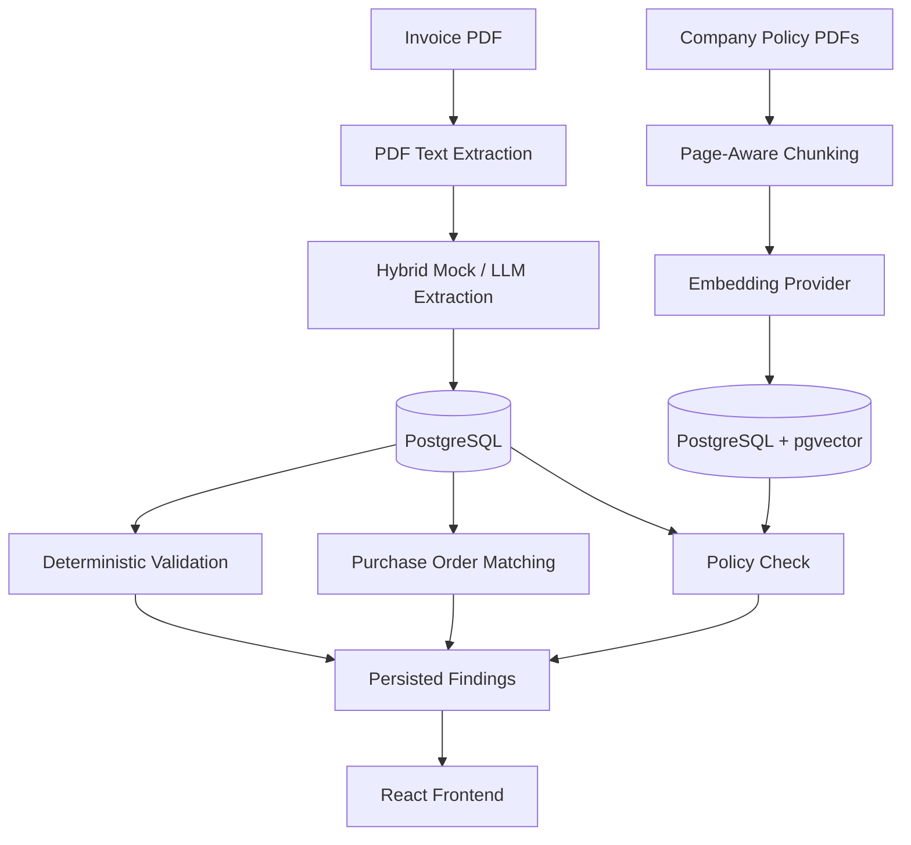

# 🧾 Invoice Intelligence & Compliance Platform

**AI-Powered Invoice Processing with Deterministic Validation and Evidence-Based Compliance**

An auditable invoice processing platform that combines LLM-powered document extraction, deterministic financial validation, purchase order matching, and retrieval-augmented policy compliance.

The goal is to automate invoice analysis while keeping every finding reproducible, explainable, and traceable to its source.

    

## 📌 Overview

Invoice processing involves more than extracting fields from documents. Financial workflows require consistent validation, purchase order reconciliation, policy checks, and a reliable record of how each finding was produced.

Invoice Intelligence & Compliance Platform separates probabilistic extraction from deterministic analysis.

The MVP uses a deterministic hybrid mock provider for invoice extraction. Subsequent validation and purchase order matching operate on the extracted fields using explicit rules, comparisons, and tolerances.

The platform also supports policy retrieval through a RAG pipeline, with evidence linked to actual source documents and stored chunks.

### Core Capabilities

- **Invoice extraction** — Convert PDF documents into structured invoice data.
- **Deterministic validation** — Evaluate extracted fields using repeatable validation rules.
- **Purchase order matching** — Compare invoice references, descriptions, quantities, unit prices, and line totals.
- **Policy intelligence** — Retrieve relevant company policy passages using PostgreSQL and pgvector.
- **Evidence-backed findings** — Preserve discrepancies, compared values, severity, and supporting evidence.
- **Independent analysis stages** — Re-run individual stages without overwriting unrelated results.
- **Audit-preserving deletion** — Soft-delete invoices while retaining their historical records.

## 🎯 Design Goals

The platform is built around four engineering principles.

### 1. Determinism Where It Counts

Only invoice extraction uses an LLM provider. Validation and purchase order matching use deterministic logic over persisted invoice fields.

Given the same inputs and configuration, these stages produce reproducible results.

### 2. Evidence, Not Just Verdicts

A finding should explain what was checked, which values were compared, how they differed, and how severe the discrepancy is.

Policy findings additionally preserve the retrieved text, source document, page number, similarity score, and retrieval query.

### 3. Independent Analysis Stages

Upload, extraction, validation, and purchase order matching persist their results independently.

Re-running validation updates validation results without overwriting extraction data or purchase order matching results.

### 4. Audit History Is Preserved

Invoice deletion does not physically remove the underlying records. The platform preserves the document, line items, analysis results, and audit events.

Terminal decisions are also protected from being overwritten by subsequent analysis.

## 🏗️ Architecture



### Processing Pipeline

```
Invoice PDF
     |
     v
Text Extraction (PyMuPDF)
     |
     v
Structured Field Extraction
     |
     v
Persisted Invoice Data
     |
     +--------------------+
     |                    |
     v                    v
Deterministic         Purchase Order
Validation            Matching
     |                    |
     +----------+---------+
                |
                v
       Evidence and Findings
                |
                v
        React Frontend
```

Policy retrieval operates alongside these stages using separately ingested company policy documents.

## ⚙️ Technology Stack

| Layer | Technologies |
|---|---|
| Backend | Python 3.11+, FastAPI |
| ORM and migrations | SQLAlchemy, Alembic |
| Frontend | React, TypeScript, Vite |
| Database | PostgreSQL |
| Vector search | pgvector |
| PDF processing | PyMuPDF |
| Structured extraction | `MockLLMProvider`, pluggable `LLMProvider` |
| Policy retrieval | RAG, cosine similarity |
| Embeddings | Pluggable `EmbeddingProvider` |
| Testing | pytest, Ruff, TypeScript |

## 🔍 Invoice Processing

### 1. Document Upload

Invoices are uploaded as PDF documents and persisted with their associated invoice records.

```
POST /api/v1/invoices/upload
```

Example:

```bash
curl -X POST \
  http://localhost:8000/api/v1/invoices/upload \
  -F "file=@invoice.pdf"
```

### 2. Structured Extraction

The extraction stage processes document text and uses the configured `LLMProvider` to produce structured invoice fields.

The shipped `MockLLMProvider` uses SHA-256 fixture matching and regex parsing for unknown documents. It requires no API key.

```
POST /api/v1/invoices/{id}/analyze
```

The extracted data becomes the input for subsequent analysis stages.

### 3. Deterministic Validation

Validation applies explicit rules to the extracted invoice fields.

```
POST /api/v1/invoices/{id}/validate
GET  /api/v1/invoices/{id}/validation
```

Validation results are persisted independently and can be retrieved without rerunning extraction.

### 4. Purchase Order Matching

The matching engine compares invoice data against its referenced purchase order.

```
POST /api/v1/invoices/{id}/match-po
GET  /api/v1/invoices/{id}/po-match
```

Matching includes:

- Exact purchase order number comparison
- Normalized description similarity
- Quantity comparison
- Unit price comparison
- Line total comparison
- Tolerance-based discrepancy evaluation

Each comparison records its result, evidence, and severity.

## ⇄ Purchase Order Matching

The matching engine classifies its results into four outcomes.

| Result | Description |
|---|---|
| `MATCH` | Compared values satisfy the matching rules. |
| `PARTIAL_MATCH` | Some comparisons match while others have discrepancies. |
| `MISMATCH` | One or more comparisons fail the matching rules. |
| `SKIPPED` | Matching cannot proceed with the available reference data. |

A `MISMATCH` transitions an invoice to `NEEDS_REVIEW` unless the invoice already has a terminal status.

No LLM is involved in purchase order comparison.

### Known Limitation

The `acme-simple` and `initech-missing-fields` fixtures do not contain a purchase order number. Purchase order matching therefore returns `SKIPPED` for these fixtures.

See Architecture and known limitations.

## ⌕ Policy Intelligence (RAG)

The policy retrieval pipeline makes company policy documents searchable and attaches source-backed evidence to invoice checks.

### Ingestion Workflow

```
Company Policy PDFs
        |
        v
PDF Text Extraction
        |
        v
Page-Aware Chunking
        |
        v
Embedding Generation
        |
        v
PostgreSQL + pgvector
        |
        v
Cosine Similarity Search
        |
        v
Retrieved Policy Evidence
```

### Policy Endpoints

Search indexed policies:

```
POST /api/v1/policies/search
```

Attach policy evidence to an invoice:

```
POST /api/v1/invoices/{id}/policy-check
```

### Evidence Integrity

Every retrieved evidence item preserves:

- Verbatim text from the source chunk
- Source document
- Page number
- Similarity score
- Exact retrieval query

If retrieval returns no evidence, the evidence list remains empty and the finding is marked `skipped`.

The system never fabricates policy quotations.

This behavior is tested in `tests/test_policy_no_fabrication.py`, which verifies that every cited `chunk_id` exists in the database.

### Embedding Provider

The MVP includes `HashEmbeddingProvider`, a deterministic, hash-based embedding provider that runs offline without external embedding API costs.

Its retrieval quality is primarily lexical rather than semantic.

The `EmbeddingProvider` protocol allows a semantic embedding model, such as a local transformer or commercial embedding API, to be introduced through configuration without changing the retrieval service or frontend.

## 🔒 Invoice Lifecycle and Auditability

### Soft Deletion

Invoices are soft-deleted using:

```
DELETE /api/v1/invoices/{id}
```

The operation sets `deleted_at` and records an audit event instead of physically removing the invoice.

| Behavior | Result |
|---|---|
| Active invoice listing | Deleted invoices are excluded. |
| Fetch deleted invoice | Returns `410 Gone`. |
| Downstream analysis | Deleted invoices are treated as non-existent. |
| Documents and line items | Preserved. |
| Analysis results | Preserved. |
| Audit event history | Preserved. |
| Hard deletion | Not implemented. |

The distinction between `410 Gone` and `404 Not Found` preserves the fact that the resource existed but was subsequently deleted.

### Terminal Status Protection

The following invoice statuses are terminal:

- `APPROVED`
- `REJECTED`
- `FAILED`

Analysis stages may still record findings, but they cannot overwrite a terminal decision.

This prevents a later validation or matching run from silently changing a previously finalized outcome.

## ⏱️ Independent Analysis Stages

Each stage owns its own persisted results.

| Stage | Operation | Effect of Re-running |
|---|---|---|
| Upload | Create invoice and persist document | Follows upload and duplicate-handling rules |
| Extraction | Analyze document | Rewrites extraction-stage results |
| Validation | Evaluate invoice fields | Rewrites validation results only |
| PO matching | Compare against purchase order | Rewrites PO matching results only |
| Policy check | Retrieve policy evidence | Rewrites policy-check results only |

The intended invariant is that re-running one analysis stage does not disturb the persisted results of another.

## ⚡ Quick Start

### Prerequisites

- Python 3.11+
- Node.js 18+
- Docker and Docker Compose
- PostgreSQL with pgvector

No LLM API key is required. The MVP ships a deterministic hybrid mock provider (SHA-256 fixture matching plus regex parsing for unknown documents). A real provider (local model or commercial API) implements the same `LLMProvider` protocol and is swapped in by config.

### 1. Clone the Repository

```bash
git clone <YOUR_GITHUB_REPOSITORY_URL>
cd <YOUR_REPOSITORY_DIRECTORY>
```

### 2. Configure the Environment

```bash
cp .env.example .env
```

On Windows PowerShell:

```powershell
Copy-Item .env.example .env
```

Configure the database connection and other required settings in `.env`.

### 3. Start PostgreSQL

```bash
docker compose up -d postgres
docker compose ps   # confirm "Up (healthy)"
```

### 4. Set Up the Backend

Create a virtual environment:

```bash
python -m venv .venv
```

Activate it on Windows:

```powershell
.venv\Scripts\Activate.ps1
```

Or on macOS/Linux:

```bash
source .venv/bin/activate
```

Install dependencies and apply migrations:

```bash
pip install -e .
alembic upgrade head
```

Start the API:

```bash
uvicorn app.main:app --reload
```

### 5. Set Up the Frontend

Open a separate terminal:

```bash
npm install
npm run dev
```

The Vite development server proxies `/api/*` to `http://localhost:8000`.

### 6. Open the Application

| Service | Address |
|---|---|
| Backend API | `http://localhost:8000` |
| Interactive API documentation | `http://localhost:8000/docs` |

## 🚀 One-Command Demo

With the backend running, from `backend/` with the venv active:

```bash
python scripts/demo_high_risk.py --reset
```

This runs the full pipeline on a fixture invoice: it uploads the document twice to trigger duplicate detection, creates a mismatched purchase order to trigger PO mismatch, and reaches a HIGH risk score. A review case is opened automatically.

Open `http://localhost:5173/reviews` to work the case.

See `backend/scripts/README.md` for a step-by-step description.

## 🧪 Testing and Code Quality

### Backend

```bash
pytest -v
ruff check .
```

Backend tests run against a real PostgreSQL database, with changes rolled back to a savepoint for test isolation.

### Frontend

```bash
npx tsc --noEmit
npm run build
```

### Core Guarantees

- Deterministic validation and PO matching
- Independently re-runnable analysis stages
- Terminal-status protection
- Database-backed policy evidence integrity
- Soft deletion with audit history preservation

## 📁 Project Documentation

| Resource | Description |
|---|---|
| `docs/architecture.md` | Architecture and known limitations |
| Interactive API docs | API exploration when running locally |
| `.env.example` | Environment configuration template |
| `tests/test_policy_no_fabrication.py` | Policy evidence integrity tests |
| `backend/scripts/README.md` | Demo script documentation |

## ⚠️ Current Limitations

- LLM provider: No LLM API key is required. The MVP ships a deterministic hybrid mock provider (SHA-256 fixture matching plus regex parsing for unknown documents). A real provider (local model or commercial API) implements the same `LLMProvider` protocol and is swapped in by config.
- PO reference availability: Matching requires a usable purchase order reference and corresponding data.
- Lexical retrieval: The default hash-based embedding provider does not provide the semantic quality of a dedicated embedding model.
- Retrieval coverage: Policy findings depend on the indexed documents and the quality of retrieval.
- Operational configuration: Database and embedding settings must be configured for the relevant workflows.

## 🔮 Potential Improvements

- Semantic embedding models for improved policy retrieval
- More comprehensive purchase order and invoice fixture coverage
- Expanded validation rules and configurable financial tolerances
- Stronger integration tests for terminal-status transitions
- More extensive policy retrieval evaluation
- Production deployment and observability improvements

## 💡 Key Takeaway

Invoice Intelligence & Compliance Platform separates extraction from evaluation to make automated invoice processing easier to audit and reason about.

The architecture combines:

- LLM-Based Extraction
- Deterministic Validation
- Purchase Order Reconciliation
- Evidence-Backed Policy Retrieval
- Audit-Trail Preservation

The result is a foundation for invoice automation in which findings are not merely generated — they are reproducible, explainable, and traceable to persisted data and source evidence.

## 👤 Project Status

Status: MVP

The project implements the core invoice extraction, deterministic validation, purchase order matching, policy retrieval, and audit-preserving lifecycle workflows.

For implementation details and known limitations, see `docs/architecture.md`.

---

**Extract intelligently. Validate deterministically. Preserve the evidence.**